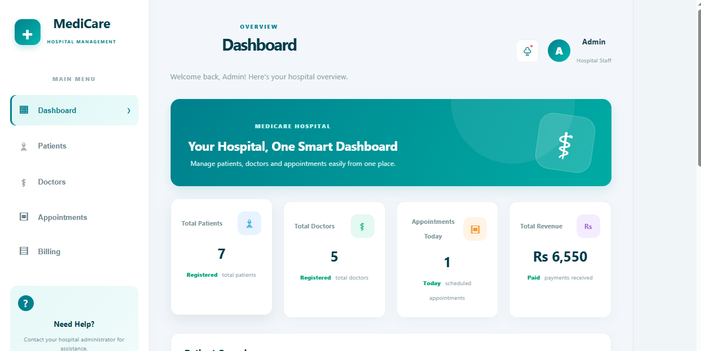
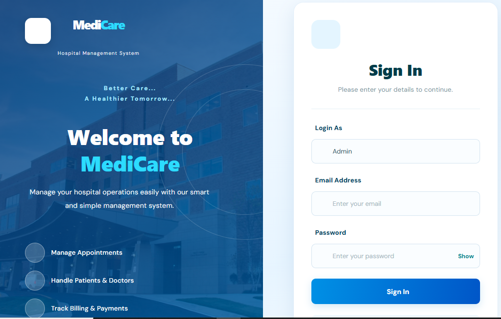

# Hospital Management System

## Project Overview
The Hospital Management System is a responsive front-end web application developed to simulate hospital management operations. It provides a user-friendly interface for managing patients, doctors, appointments, and billing.

This project is developed as an individual Front-End Internship Project. It focuses on responsive design, reusable components, and interactive functionality.

**Note:** This is a front-end-only project. No backend or database is used. Mock data is used to simulate hospital operations.

## Live Demo
[View Live Project](https://hospital-management-xi-coral.vercel.app/)

## Features
- Responsive user interface
- Interactive hospital dashboard
- Patient management
- Doctor management
- Appointment management
- Billing and invoice management
- Search and filtering
- User-friendly navigation

## Technologies Used
- React.js
- JavaScript
- HTML5
- CSS3
- Vite
- Git and GitHub
- Vercel (Deployment)

## Installation and Setup

Follow these steps to run the project on your local machine.

**1. Clone the repository**

```bash
git clone https://github.com/jav-eria/Hospital-Management.git
```

**2. Navigate to the project folder**

```bash
cd Hospital-Management
```

**3. Install dependencies**

```bash
npm install
```

**4. Start the development server**

```bash
npm run dev
```

**5. Open the application**

Open the local URL provided by Vite in your browser.

## Screenshots

Screenshots of the Hospital Management System will be added here to demonstrate the user interface and functionality.

## Deployment

The project is deployed on Vercel.

**Live URL:** https://hospital-management-xi-coral.vercel.app/

## Future Improvements
- Backend integration
- Database connectivity
- Secure user authentication
- Advanced reporting and analytics
- Additional hospital management features

## Project Information
- **Project Name:** Hospital Management System
- **Project Type:** Front-End Internship Project
- **Development Type:** Individual Project
- **Framework:** React.js
- **Build Tool:** Vite
- **Deployment Platform:** Vercel

## Author

**Javeria Israr**

GitHub: https://github.com/jav-eria

## License

This project is developed for educational and internship purposes.
## Screenshots

### Dashboard


### Login Page


